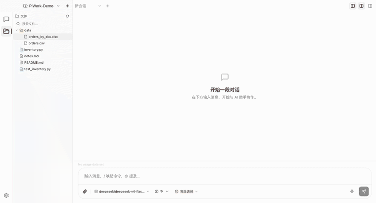

# PiWork-Plugin-Browser

[简体中文](README.md) | English

**Official PiWork plugin · Browser automation · `com.pi.browser`**

Hands the browser embedded in PiWork to the agent: open pages, inspect the page structure, click, fill forms, upload files, scroll, take screenshots, or let it walk through a multi-step goal by itself. The Browser panel shows the very page the agent is operating on — when it navigates, your side follows; when you switch tabs or interact with the page yourself, the agent sees the same page. Login state is shared with the host browser, so there is nothing to sign in to again.

## Browser automation in PiWork



## What it does

- **Page interaction** — navigate, click, fill, select from dropdowns, hover, scroll, and upload local files; same-origin and cross-origin iframes, drag-and-drop uploads, and native confirmation dialogs are supported. Every step can be verified by reading the page state back.
- **Page understanding** — returns a snapshot of interactive elements (buttons / links / inputs, each with a ref), supports fuzzy text search, and can run in-page JS or take screenshots when needed.
- **Tabs and split view** — open, switch, and close tabs; in a split view each page is independent, and the address bar and history follow the focused tab.
- **History and favorites** — every navigation is recorded (deduplicated by URL, latest 500 entries); star favorite sites for one-click access from the address bar. The agent can query both, so “that site from last time” does not need to be retyped.
- **Recipes** — a successful batch of actions on a favorite site is recorded as a recipe (steps, targets, fallback locators). The agent can replay a recipe later, and small site changes still hit the fallback locators.
- **Selection assistant** — select text on a page to get Translate / Explain / Read aloud / Save plus a question box; the agent's answer is shown directly in the popup instead of only in the conversation.
- **Full-page translation** — the “译” toolbar expands a control row: replace the original text, bilingual view, read the page aloud, explain the body text, and save the page. Translations are cached by site + source hash, so revisiting the same page does not call the model again.
- **23 agent tools** — covering navigation, reading, interaction, tabs, history, favorites, recipes, and display.

## Install in PiWork

1. Open the PiWork desktop app.
2. Right panel → **Plugin Center** → **Browser automation** → Install.
3. The first install shows the permission list; after confirmation the package is downloaded and verified (sha256) and appears in the **Open plugin** menu.

The web app does not load plugins; browser capabilities require the desktop app.

Develop from source:

```bash
git clone https://github.com/PiWorkAgent/PiWork-Plugin-Browser
cd PiWork-Plugin-Browser
npm install
npm run build        # backend → dist/main.mjs (the SDK is bundled in)
```

Live-reload inside the PiWork repository:

```bash
PI_DEV_PLUGINS=/path/to/PiWork-Plugin-Browser pnpm dev:desktop:plugins
```

The panel is a static page under `ui/` (not a build artifact); the backend entry is declared by `backend` in `manifest.json`.

## Usage in conversation

| You say | What happens |
| --- | --- |
| “Open Hacker News and show me today's top ten” | the agent navigates, reads the snapshot, and summarizes |
| “Search GitHub for X and read me the install steps of the first repo” | navigate, search, click, read, then read aloud with host voice |
| “Fill in this form; the file is ~/Downloads/a.pdf” | `browser_fill` for the form + `browser_upload` for the local file |
| “Go back to the page I was looking at last time” | `browser_history_search` finds and opens it |
| “Translate this English paragraph” | selection popup → the agent uses `browser_show` to render the translation in the popup |
| “Save this page; next time follow the same flow” | after favoriting the site, a successful `browser_act` is recorded as a recipe |

## Tools

| Group | Tools |
| --- | --- |
| Navigation | `browser_navigate` |
| Tabs | `browser_tab_list` · `browser_tab_open` · `browser_tab_switch` · `browser_tab_close` |
| Reading | `browser_get_state` · `browser_find` · `browser_screenshot` · `browser_evaluate` · `browser_walk` |
| Interaction | `browser_click` · `browser_fill` · `browser_act` · `browser_hover` · `browser_select` · `browser_scroll` · `browser_upload` |
| History / favorites / recipes | `browser_history_search` · `browser_favorites_list` · `browser_recipes` · `browser_recipe_delete` |
| Display / clips | `browser_show` · `browser_clips_list` |

The standard loop is `browser_navigate → browser_get_state → browser_click / browser_fill → browser_get_state`. Full semantics, selector formats, and edge cases are in [PLUGIN.md](./PLUGIN.md) (this file is shipped with the plugin and given to the agent).

## Permissions

| Permission | Purpose |
| --- | --- |
| `browser` | Use the host's embedded browser engine, tabs, page sessions, and login state |
| `storage` | Plugin-private storage: history, favorites, recipes, selected-text clips |
| `voice` | Read selections and whole pages aloud (host TTS) |
| `ai` | Full-page translation and explanation (uses the user's default chat model and consumes tokens) |

## Release

1. Bump `version` in `manifest.json`
2. Commit and push a `v<version>` tag (or Actions → Release → Run workflow)

A release always contains two assets:

- `com.pi.browser-<version>.zip` — runtime payload (manifest, `dist/`, `ui/`, `assets/`, `PLUGIN.md`)
- `index.json` — a single-entry marketplace index whose `url` points at this release (absolute) and includes the `sha256`

[PiWork-Registry](https://github.com/PiWorkAgent/PiWork-Registry) periodically merges each plugin's `index.json` into the marketplace index read by the client.

## Layout

| Path | Purpose |
| --- | --- |
| `manifest.json` | Plugin manifest: id, version, `apiVersion`, permissions, panels, tools |
| `src/backend/` | Backend source (bundled into `dist/main.mjs`) |
| `dist/` | Backend bundle (committed so the plugin can run locally) |
| `ui/` | Panel page |
| `assets/` | Runtime icons |
| `media/` | README demo assets (not shipped in the release) |
| `scripts/release.mjs` | Packaging + single-entry index generation |

## Links

- [PiWork](https://github.com/PiWorkAgent/PiWork) — the host app
- [PiWork-Registry](https://github.com/PiWorkAgent/PiWork-Registry) — marketplace index
- [Plugin development guide](https://github.com/PiWorkAgent/PiWork-Plugin-Docs/blob/main/docs/plugin-dev-guide.md)
- [Plugin SDK `@weiqun789/plugin-sdk`](https://www.npmjs.com/package/@weiqun789/plugin-sdk)
- [PLUGIN.md](./PLUGIN.md) — the agent-facing usage guide
