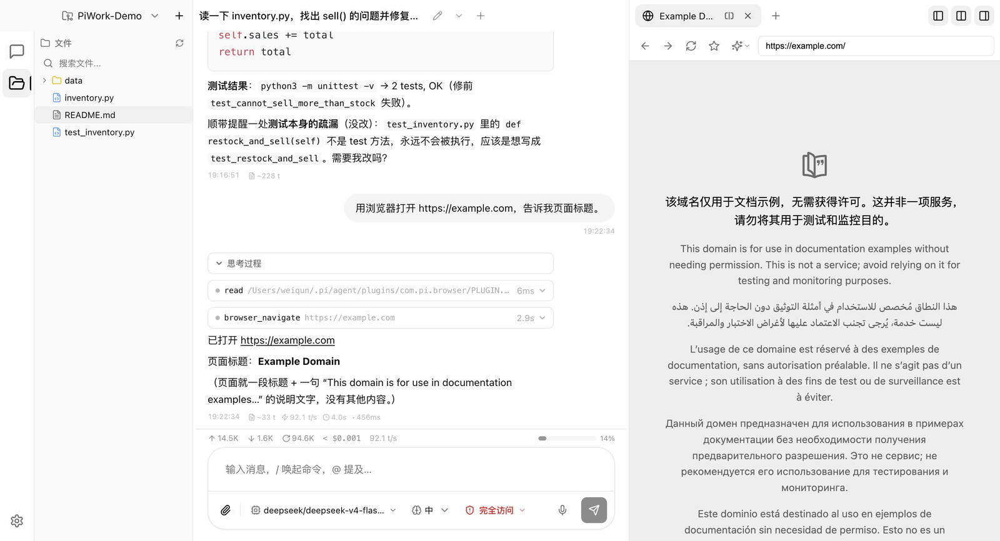

# PiWork-Plugin-Browser

PiWork 插件：把浏览器放进 PiWork 的右栏，并把操作网页的能力交给 agent。插件 id `com.pi.browser`。

> 需要 PiWork 桌面端（Web 端不加载插件）。在 PiWork 的「插件中心」安装；安装、更新、回滚由客户端通过 [PiWork-Registry](https://github.com/PiWorkAgent/PiWork-Registry) 完成。



## 功能

- **内嵌浏览器** — 右栏就是浏览器：地址栏、前进 / 后退 / 刷新、多标签页、收藏与历史。
- **agent 操作网页** — 打开网址、读取页面可交互元素（每个元素带 ref）、点击、填表、下拉选择、上传文件、悬停、滚动、截图；支持同源与跨域 iframe、拖拽上传和原生确认框。
- **页面内划词** — 选中文字弹出复合框：引用、翻译、解释、朗读、收藏；回车把问题连同引用发送到对话，答案回显在框内。
- **整页阅读** — 工具栏一行完成整页翻译、导读与内容分析。
- **收藏与历史** — agent 能理解「打开我常用的那个网站」「上次打开的那个页面」并直接打开。
- **操作录制** — 在收藏站点上成功跑完一组操作后自动记为 recipe，下次复用并跟踪是否还能跑通。

浏览器引擎与登录态归 PiWork 宿主；插件负责面板、地址栏和页面操作。

## 权限

安装时请求 `browser`、`storage`、`voice`、`ai` 权限：

- `browser` — 驱动宿主内嵌的浏览器引擎
- `storage` — 保存收藏、历史与 recipe
- `voice` — 划词朗读
- `ai` — 划词翻译 / 解释时调用模型

## 安装

在 PiWork 里打开插件中心，搜索「浏览器」并安装。安装、更新、回滚都走真实市场流程（sha256 校验、权限确认、原子替换）。

## 开发

```bash
npm install
npm run build        # 后端 → dist/main.mjs（SDK 会被打包进去）
```

在 PiWork 仓库里实时调试：

```bash
PI_DEV_PLUGINS=/path/to/PiWork-Plugin-Browser pnpm dev:desktop:plugins
```

面板是 `ui/` 下的静态页面（不是构建产物），后端入口由 `manifest.json` 的 `backend` 声明。

## 发布

1. 改 `manifest.json` 的 `version`
2. 提交并推送 tag `v<version>`（或 Actions → Release → Run workflow）

Release 固定包含两个资产：

- `com.pi.browser-<version>.zip` — 运行时负载（manifest、`dist/`、`ui/`、`assets/`、`PLUGIN.md`）
- `index.json` — 单条目市场索引，`url` 指向本 Release（绝对地址），带 `sha256`

registry 会定时把各插件的 `index.json` 合并成客户端读的市场索引。

## 目录

| 路径 | 说明 |
| --- | --- |
| `manifest.json` | 插件清单：id、版本、`apiVersion`、权限、面板、工具 |
| `src/backend/` | 后端源码（打包成 `dist/main.mjs`） |
| `dist/` | 后端打包产物（已提交，便于本地直接跑） |
| `ui/` | 面板页面 |
| `assets/` | 图标与 README 截图 |
| `PLUGIN.md` | 给 agent 的使用说明（随插件一起发布） |
| `scripts/release.mjs` | 打包 + 生成单条目索引 |

## 相关

- 插件开发指南：[PiWork-Plugin-Docs](https://github.com/PiWorkAgent/PiWork-Plugin-Docs/blob/main/docs/plugin-dev-guide.md)
- 后端 SDK：[`@weiqun789/plugin-sdk`](https://www.npmjs.com/package/@weiqun789/plugin-sdk)
- agent 使用说明：[PLUGIN.md](./PLUGIN.md)
